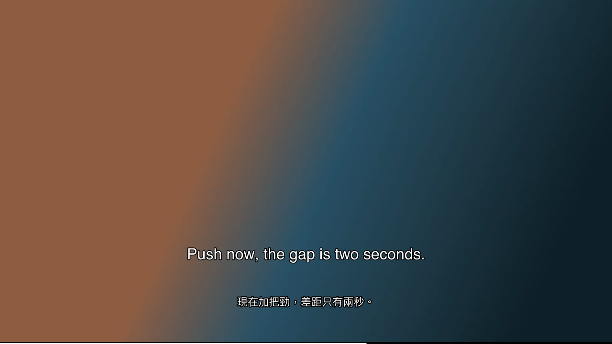

# 看懂 KanDong

**影片沒中文字幕？一看就懂。** 看懂是免費開源的影片播放器：外語片自動在原文字幕下方加上台灣繁中譯文；沒有字幕的片，先用語音辨識聽寫出字幕再翻譯。
播你自己的影片檔，不提供影片、不下載字幕；翻譯在你自己的電腦上跑，影片和字幕不會上傳到任何地方。

官網與圖文教學：<https://kandong.twtools.cc>　｜　下載：[最新版](https://github.com/dvdmaru/kandong/releases/latest)



## 能做什麼

- **雙語字幕**：外掛字幕（.srt／.ass／.vtt）或 mkv 內嵌字幕，自動在下方加上繁中譯文；整部片的字幕會先翻好，不會一句一句等。
- **沒字幕也能看**：自動用語音辨識（whisper.cpp）聽寫，再翻譯。
- **譯文快取**：翻好的存在影片旁邊（`<影片名>.ft.zh-TW.json`／`.srt`），重看不必再翻。
- **台灣用語**：翻譯提示詞針對台灣繁中調過（口語、俚語意譯、運動術語），不是逐字直翻。
- **好操作**：右鍵選單、控制列、倍速（0.5x–3x，變速不變調）、字幕軌與音軌用滑鼠選。

## 三步開始

到 [Releases](https://github.com/dvdmaru/kandong/releases/latest) 下載：

| 檔案 | 平台 | 說明 |
|---|---|---|
| `KanDong-windows-x64.zip` | Windows 10／11（64 位元） | 解壓即用，內附播放器、翻譯引擎、語音辨識引擎 |
| `KanDong-mac.zip` | macOS（Apple 晶片） | 先裝 Homebrew，再跑一次 `brew install mpv ffmpeg llama.cpp whisper-cpp` |

1. **解壓**到任何地方。
2. **拿翻譯模型**（只要一次）：雙擊「一鍵下載模型」，或照 `models/把模型放這裡.txt` 的連結自己下載後放進 `models` 資料夾。
3. **雙擊「看懂」**（Mac 是「看懂.command」）：自動開翻譯引擎，再開播放器，把影片拖進去就開始播。

| 模型 | 大小 | 什麼時候選 |
|---|---|---|
| Hy-MT2 7B（標準） | 約 4.6GB | 記憶體 16GB 以上，翻得比較好 |
| Hy-MT2 1.8B（輕量） | 約 1.1GB | 記憶體 8GB 或電腦較舊，快很多 |
| Whisper large-v3-turbo（語音辨識） | 約 574MB | 只有看沒字幕的影片才需要 |

實測速度（Apple M4／16GB，含 12 句前文）：7B 每句約 1–1.5 秒，1.8B 約 0.25 秒；有字幕的片會先翻好整部，看的時候幾乎不用等。

## 進階：自己開翻譯伺服器

播放器把字幕送到一個 OpenAI 相容的 `/v1/chat/completions` 端點翻譯，預設是同一台電腦的 `http://127.0.0.1:8080`；
「看懂」啟動器只在這個設定指向本機時才自動開引擎。

```bash
bash server/start-translate-server.sh                      # 翻譯（模型放 models/，沒有就自動下載 7B）
KANDONG_MODEL=1.8b bash server/start-translate-server.sh   # 輕量模型
bash server/start-whisper-server.sh                        # 只有看沒字幕的片才需要
```

**伺服器放在區網另一台電腦**（例如用 Mac 跑模型、Windows 看片）：伺服器那台用 `KANDONG_LAN=1` 啟動（會強制 API key，key 存在 `~/.config/kandong/api-key`），
播放器的 `floattranslate.conf` 改 `endpoint`、`asr_endpoint` 並填 `api_key`。只開在信任的區網，不要轉發到公網。

## 操作

| 按鍵 | 功能 |
|---|---|
| 滑鼠右鍵 | 選單：播放、字幕、音訊、翻譯、倍速、設定 |
| Ctrl+t | 翻譯開／關 |
| ← / → | 退／進 5 秒（Shift：30 秒） |
| 1 – 5 | 倍速 0.5x／1x／1.5x／2x／3x |
| D / A / S | 加速 10%／減速 10%／回到 1x |
| ↑ / ↓ | 音量 ±5% |
| = / - | 字幕放大／縮小 |
| v | 隱藏原文字幕（只看譯文） |
| 空白鍵／f／q | 暫停／全螢幕／離開 |

## 刻意不做

- 不下載字幕、不攔截串流、不破解 DRM——Netflix 等串流平台不支援。
- 不做圖形字幕（藍光 PGS 等）的文字辨識；這類片走語音辨識。

## 已知限制

- 人名常被音譯（例如 Marcus → 馬庫斯），換大模型也一樣；之後會做譯名修正。
- 「模型」選單目前只是預告；換模型＝把想用的模型放進 models（兩個都放時依記憶體自動挑）。
- 控制列展開時，字幕不會自動往上讓位（目前把字幕固定放在稍高的位置）。

## 從原始碼執行（Mac）

```bash
brew install mpv ffmpeg llama.cpp whisper-cpp
bash mac/download-models.sh                  # 下載模型到 models/
bash mac/kandong.sh                          # 自動開引擎＋開空視窗，把影片拖進去
```

設定裝在 `~/.config/kandong/mpv/`，不動你原本的 mpv 設定。程式結構：

- `scripts/floattranslate.lua`：翻譯、聽寫、快取、雙語顯示（mpv Lua 腳本；`floattranslate` 是內部代號）
- `ui/`：介面（[uosc](https://github.com/tomasklaen/uosc) 設定、右鍵選單、台灣繁中介面文字）
- `server/`：翻譯與語音辨識伺服器啟動腳本
- `packaging/`：產生下載包（含 Windows 啟動器 `packaging/windows/`）

## 授權

看懂本身是 [MIT](LICENSE)。內附與使用的第三方元件（mpv、FFmpeg、uosc、Hy-MT2 等）見 [THIRD_PARTY.md](THIRD_PARTY.md)。
